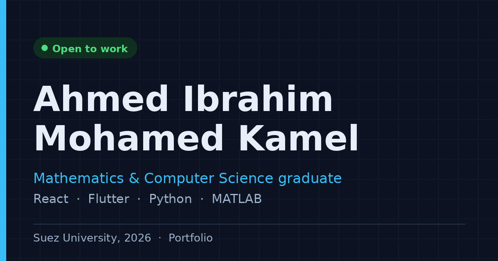

# Ahmed Ibrahim Mohamed Kamel — Portfolio



Personal portfolio of a Mathematics and Computer Science graduate (Suez University, 2026): web and mobile projects, applied mathematical modeling, and robotics teaching. Available in English and Arabic.

**Live site:** https://ahmedshosha3.github.io/Portfolio/

## Highlights

- Bilingual: English and Arabic with full right-to-left layout, Cairo typography and a language switch that remembers your choice
- Project pages that state what I built myself and what belongs to a team
- Screenshot viewer with keyboard and swipe navigation
- Light and dark themes with a toggle (dark by default)
- Filterable projects and searchable certificates
- Accessible by design: skip link, focus management, semantic landmarks, reduced-motion support
- Fully static, no backend

## Built with

React 18 · Vite 5 · react-i18next · plain CSS (design tokens) · hash-based routing

## Getting started

```bash
npm install
npm run dev       # http://localhost:5173
npm run build     # static files in dist/
npm run preview   # preview the production build
```

Requires Node.js 18 or newer.

## Project structure

```
src/
  data/portfolio.js   all English content: links, skills, projects, experience, certificates
  i18n/               UI strings (index.js), Arabic content (portfolio.ar.js), merge hook (useData.js)
  components/         one file per section
  hooks/              theme, hash routing, active nav link
  styles/             tokens, base, sections, project, rtl
public/
  ProjectsScreenshots/   project images and demo video
  CV.pdf
  image.png           social share image
.github/workflows/       automatic deploy to GitHub Pages
```

## Customizing

- **Content:** edit `src/data/portfolio.js`, then mirror text changes in `src/i18n/portfolio.ar.js`. Empty links stay hidden.
- **UI text:** `src/i18n/index.js` has the English and Arabic strings.
- **New project:** copy an object in `projects`, give it a new `id`, and add its Arabic text at the same position in `portfolio.ar.js`.
- **Screenshots:** place files in `public/ProjectsScreenshots/<Project>/` and list them in the project's `screenshots`. File names are case-sensitive on hosting servers.
- **Colors and fonts:** `src/styles/tokens.css` and the font link in `index.html`.

## Deploy

- **GitHub Pages (configured):** in the repo go to Settings, Pages, and set Source to "GitHub Actions". Every push to `main` then builds and publishes the site.
- **Netlify:** build command `npm run build`, publish directory `dist`.
- **Vercel:** import the repo; the Vite preset works as-is.

`base: "./"` in `vite.config.js` keeps asset paths working in sub-folders.

## License

Code is released under the [MIT License](LICENSE). The text, project screenshots, CV and personal information are not covered by it and are not for reuse.

## Contact

[LinkedIn](https://www.linkedin.com/in/ahmed-shosha-212192296/) · [GitHub](https://github.com/AhmedShosha3) · ahmed.shoshua@gmail.com
